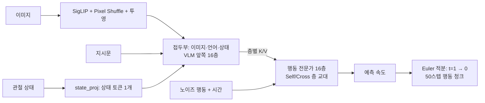
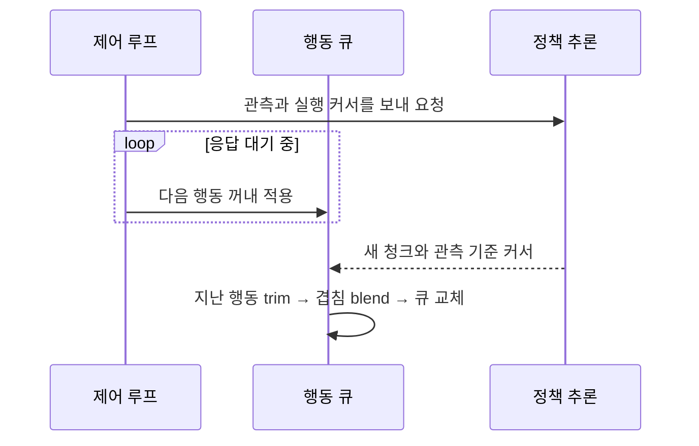

# SmolVLA 구조와 실습 안내

이 문서는 [SmolVLA 해부 노트북](smolvla_tour.py)을 읽기 위한 구조 안내입니다.
노트북은 LeRobot을 설치하지 않고 핵심 구현을 이식했습니다. 기준은
[LeRobot 리비전 e6ffde6](https://github.com/huggingface/lerobot/tree/e6ffde60312365c5452c46189a26872483943154/src/lerobot/policies/smolvla)입니다.
실제 실행 코드는 노트북의 `SmolVLMWithExpertModel`, `VLAFlowMatching`에 있습니다.
아래 작은 코드 조각은 계산을 설명하며 별도의 정책 구현이나 서버를 제공하지 않습니다.

독자는 PyTorch 텐서·역전파, Self/Cross Attention, RoPE와 KV 캐시의 기초를 안다고 가정합니다.
목표는 **관측 → 접두부 → 속도장 → 행동 청크 → 환경 적용**의 관계를 설명하는 것입니다.
설치·자원·재실행 방법은 [README](README.md), 계산별 실험은 본문에 안내한 노트북 절에서 확인합니다.

## 1. 전체 아키텍처 개요

SmolVLA는 약 0.45B 매개변수의 Vision-Language-Action 모델입니다.
고정한 시각·언어 백본과 학습 가능한 행동 전문가(Action Expert)를 연결해 연속 행동 청크를 생성합니다.
백본의 텍스트 답변을 행동으로 해석하는 방식이 아닙니다. 각 층의 K/V 표현을 행동 전문가가 참조합니다.



원본의 관절 상태·관절 목표값을 이 실습에서는 2D 에이전트 위치와 목표 위치로 바꿉니다.
장면의 빨강·파랑 점과 지시문에 따라 목표가 달라집니다. 실물 로봇의 접촉·관성·센서 오차는 모델링하지 않습니다.
좌표는 $[-1,1]$이고 이미지처럼 $x$는 오른쪽, $y$는 아래쪽으로 증가합니다.

## 2. 핵심 구성 요소

### 시각·언어 백본과 레이어 절단

기준 VLM은 `HuggingFaceTB/SmolVLM2-500M-Video-Instruct`입니다.
512×512 이미지를 16×16 패치로 나누면 1024개 패치 토큰이 됩니다.
커넥터의 Pixel Shuffle은 인접 4×4 패치를 채널 방향으로 묶습니다.

$$
(B,1024,768)\rightarrow(B,64,12288)\rightarrow(B,64,960)
$$

$B$는 배치 크기입니다. 앞 변환은 값의 재배열이고, 뒤의 선형 투영이 표현 차원을 압축합니다.
패치 토큰 수는 이미지 크기·패딩·분할 설정에 의존합니다. 여기서는 512×512 전역 이미지 한 장을 가정합니다.
VQA에서는 비전 토큰을 `<image>` 자리로 넣고, 정책에서는 이미지 토큰과 언어 토큰을 직접 이어 붙입니다.
두 입력 경로를 같은 채팅 프롬프트로 혼동하지 마세요.

정책에는 텍스트 디코더 32층 중 **앞쪽(입력 쪽) 16층**을 남깁니다.
`layers[:16]`이며 마지막 16층이나 상위 16층이 아닙니다.
노트북 4절의 ridge 프로브는 각 층 표현에서 점 좌표를 선형적으로 읽을 수 있는지 측정합니다.
그 결과만으로 최적 절단 깊이나 로봇 제어 성능을 입증할 수는 없습니다.

### 상태와 행동·시간 임베딩

상태는 `state_proj`로 VLM 폭 960의 토큰 하나가 됩니다.
관측은 이미지·언어·상태 순서의 접두부(prefix), 생성할 행동은 접미부(suffix)입니다.
실제 2D 상태·행동은 32차원까지 0으로 채우고 손실은 앞 두 행동 차원에서만 평균냅니다.
이 차원 패딩과 Episode 끝의 시간 패딩은 다릅니다. 실습의 50스텝 정답은 끝까지 정의되어 있어 시간 패딩을 쓰지 않습니다.
실물 데이터에는 별도의 정규화 통계와 Episode 마스크가 필요할 수 있습니다.

행동은 32→720으로 투영합니다. 시간의 사인파 임베딩도 720차원으로 만들고,
두 임베딩을 **이어 붙인 1440차원**을 MLP로 720차원에 되돌립니다.
시간 임베딩을 행동에 단순히 더하는 구조가 아닙니다.

### 행동 전문가와 혼합 어텐션

VLM의 폭은 960, 행동 전문가의 폭은 720입니다. 각 경로는 자기 Q/K/V/O 투영과 MLP를 가집니다.
Q는 15헤드×64, K/V는 5헤드×64이며 GQA가 K/V 헤드를 반복해 어텐션합니다.
Self 층에서 두 경로의 Q/K/V를 시퀀스 축으로 합치려면 **헤드 수와 head_dim을 포함한 투영 형상**이 맞아야 합니다.
head_dim 하나만 맞는 것으로는 충분하지 않습니다.

| 0부터 센 층 | 행동 경로의 참조 | 실제 함수 |
| --- | --- | --- |
| 짝수 Self 층 | 접두부 + 현재·이전 행동 | `forward_attn_layer` |
| 홀수 Cross 층 | 해당 VLM 층의 접두부 K/V | `forward_cross_attn_layer` |

매 블록에서 Cross와 Self를 모두 연속 실행하는 대신 층별로 교대합니다.
Cross 층은 RoPE가 적용된 VLM K/V(320차원)를 전문가의 K/V 투영층에 다시 넣습니다.
각 층에서 어텐션 출력 투영·잔차 연결과 정규화/MLP·잔차 연결을 수행합니다.
SmolVLA는 RoPE의 최대 파장 10000을 쓰며, 원 VLM 설정값과 혼동하면 공개 가중치의 계산이 달라집니다.

## 3. 추론 최적화: 비동기 실행

행동 청킹은 한 번에 미래의 50스텝을 예측하는 것입니다. 큐에서 몇 개를 실행한 뒤 다시 관측할지는 별도 선택입니다.
이 노트북의 폐루프는 앞 10개를 적용하고 새 관측으로 재추론합니다.
청크를 적용하는 매 스텝마다 신경망이 새 관측을 읽는 것은 아닙니다.

비동기 실행은 기존 큐를 소비하면서 다음 청크를 요청하는 방식입니다.
[같은 리비전의 `ChunkRuntime`](https://github.com/huggingface/lerobot/blob/e6ffde60312365c5452c46189a26872483943154/src/lerobot/inference/execution.py)을 기준으로 합니다.



원본의 요청 판단은 큐 재생시간과 다음 유효 임계값을 비교합니다.

$$
T_{\mathrm{refill}}=\max(T_{\mathrm{configured}},\ T_{\mathrm{turnaround}}+\Delta t)
$$

$T_{\mathrm{turnaround}}$는 관측된 왕복 지연, $\Delta t$는 제어 간격입니다.
진행 중인 요청이 없고 남은 재생시간이 이 임계값 이하일 때 요청합니다.
노트북 11절은 이를 고정된 **tick 수 임계값**으로 단순화하며, 지연 추정과 실제 네트워크·스레드는 구현하지 않습니다.

정렬은 단순한 벽시계 지연만이 아니라 **관측 이후 실제로 소비한 행동 수**를 기준으로 합니다.
관측 커서가 10이고 현재 커서가 14면 새 청크 앞의 4개를 버립니다.
그동안 큐가 비어 행동을 소비하지 못했다면 경과 tick 수와 trim 수는 다를 수 있습니다.
겹치는 앞 `blend_steps`개는 기본 고정 가중치 $w=0.5$로 섞습니다.

$$
a_i=(1-w)a_i^{\mathrm{old}}+w a_i^{\mathrm{new}}
$$

나머지는 새 청크로 교체합니다. 점차 새 청크 비중을 키우는 스케줄은 가능한 변형이며 이 고정 리비전의 기본 규칙과 다릅니다.
RTC는 단순 혼합과 다른 생성 방식으로, 실습은 구현하지 않습니다.

큐가 충분하면 추론 대기로 인한 멈춤을 줄일 수 있습니다. 지연이 크거나 청크가 만료되면 큐가 바닥날 수 있습니다.
Python 스레드와 `sleep`은 실시간 제어 주기나 물리 시간과의 완전한 일치를 보장하지 않습니다.
또한 **관절 상태가 같다는 이유만으로 이전 청크를 재사용하면 안 됩니다**. 이미지·지시문·작업 세션이 달라질 수 있습니다.
여기서는 상태 차이만 보는 가상의 `PolicyServer`를 실제 LeRobot 구현으로 제시하지 않습니다.

## 4. 다른 VLA와 비교

| 구분 | OpenVLA | π0 | SmolVLA |
| --- | --- | --- | --- |
| 행동 표현 | 이산 행동 토큰 | 연속 Flow Matching | 연속 Flow Matching |
| 백본 계열 | Prismatic VLM | PaliGemma | SmolVLM2 앞쪽 16층 |
| 이 실습에서 다루는 범위 | 비교 배경 | 비교 배경 | 이식 구현·공개 가중치 연결 |

모델 규모만으로 특정 GPU에서의 실시간성을 보장할 수 없습니다.
이미지 수·해상도·배치·정밀도·적분 횟수·제어 주기에 따라 시간과 메모리가 달라집니다.
이 노트북은 다른 VLA의 체크포인트나 하드웨어 성능을 직접 비교하지 않습니다.

## 5. 블록 어텐션 마스크

`att_masks`는 허용 여부 자체가 아니라 **새 블록의 시작**을 표시합니다.
이미지·언어는 0, 상태는 1, 각 행동은 1입니다. 누적합 $b_i$를 쓰면 허용 조건은 다음과 같습니다.

$$
M_{qk}=[b_k\le b_q]\land p_q\land p_k
$$

$p_i$는 유효 토큰 여부이며 False인 패딩은 행·열 모두 막습니다.

| Query | 이미지·언어 Key | 상태 Key | 행동 Key |
| --- | --- | --- | --- |
| 이미지·언어 | 양방향 | 차단 | 차단 |
| 상태 | 허용 | 자기 자신 | 차단 |
| 행동(Self 층) | 허용 | 허용 | 현재·이전 행동 |
| 행동(Cross 층) | 허용 | 허용 | 차단 |

```python
block = torch.cumsum(att_masks, dim=1)
mask = (block[:, None, :] <= block[:, :, None])
mask = mask & pad_masks[:, None, :] & pad_masks[:, :, None]
```

Query는 행, Key는 열입니다. Prefix가 행동을 보지 않으므로 행동 노이즈가 바뀌어도 Prefix 표현은 같습니다.
이 마스크 조건이 KV 캐시 재사용의 근거입니다. 마스크를 바꾸면 학습된 체크포인트의 전제도 달라집니다.

## 6. Flow Matching의 학습과 추론

노트북은 원본의 **NOISE_AT_ONE** 시간 방향을 따릅니다.
정답 행동 청크 $a$와 같은 형상의 정규 노이즈 $\epsilon$을 뽑습니다.

$$
x_t=(1-t)a+t\epsilon,\quad u_t=\epsilon-a,\quad
L=\mathbb E[\|v_\theta(x_t,t,c)-u_t\|^2]
$$

조건 $c$는 이미지·언어·상태입니다. $t=1$은 노이즈이고 $t=0$은 행동입니다.
학습 시간은 $t=0.001+0.999z$, $z\sim\operatorname{Beta}(1.5,1)$로 뽑아 노이즈 쪽을 더 자주 학습합니다.
`forward`의 원소별 손실은 $(B,H,32)$이며 실습에서는 앞 2차원만 평균냅니다. $H=50$은 행동 청크 길이입니다.
VLM은 동결하고 행동 전문가·상태/행동/시간 투영층을 갱신합니다.

추론에는 정답 행동이 없습니다. $x_1=\epsilon$에서 $\Delta t=-1/N$로 역방향 적분합니다.

$$
x_{t+\Delta t}=x_t+\Delta t\,v_\theta(x_t,t,c),\qquad t:1\rightarrow0
$$

기본 $N=10$입니다. 정답 $a=2$, 노이즈 0이면 목표 속도는 $-2$이며,
정확한 속도장에서 두 번의 $\Delta t=-0.5$ 갱신은 $0\to1\to2$를 만듭니다.
$t=0$을 노이즈로 정의하는 반대 시간 규약도 가능하지만, 이미 학습된 속도장의 입력 시간·부호를 임의로 섞으면 안 됩니다.

여러 정답이 있는 조건에서 단일 MSE 행동 회귀는 조건부 평균을 낼 수 있습니다.
Flow Matching은 노이즈를 통해 여러 해를 표현할 수 있으나, 유한한 학습과 적은 적분 횟수에서 모든 모드를 복원한다는 보장은 없습니다.
7절 토이 학습은 별도 버튼으로 실행하고 적분 횟수별 분포와 손실을 관찰합니다.

## 7. KV 캐시의 범위와 검증

하나의 관측에서 접두부를 한 번 계산하고, 10회 Euler 갱신 동안 같은 층별 K/V를 재사용합니다.
새 장면·새 상태·새 지시문이면 새 관측이므로 캐시도 다시 만듭니다.

- Self 층은 접두부 캐시에 현재 행동 K/V를 붙이고, 갱신 뒤 행동 부분을 잘라 접두부 길이를 복원합니다.
- Cross 층은 접두부 K/V를 읽으며 행동 K/V를 캐시에 누적하지 않습니다.
- 동일 가중치·관측·마스크·위치·정밀도·행동 노이즈에서 전체 경로와 캐시 경로의 속도를 비교합니다.
  차이가 크면 캐시 길이·위치·마스크·dtype을 점검해야 하며 모든 차이를 반올림 탓으로 돌리지 않습니다.

비전/토큰 임베딩을 고정한 벤치마크와, 비전부터 전체 관측을 매번 재계산하는 벤치마크는 측정 범위가 다릅니다.
노트북 8절은 **같은 관측의 Transformer 접두부 계산을 캐시할 때의 효과**를 비교합니다.
속도 수치는 해당 배치·기기에서의 관측값이며 일반적인 배수 향상으로 해석하지 않습니다.

## 8. 장난감 과제의 평가와 연습

폐루프에서 청크 앞 10개를 실행하고 새 관측으로 다시 추론합니다.
지정한 점의 반경 0.1 안에 먼저 들어가면 성공, 다른 점에 먼저 들어가면 오답이며 나머지는 시간 초과입니다.
기본 모델과 파인튜닝 모델은 같은 장면·같은 Episode 수·같은 노이즈 seed·같은 적용 길이로 비교합니다.
문장 교체는 같은 장면·같은 노이즈에서 문장만 바꿉니다. 여러 seed로 재검증해야 하며 궤적 차이만으로 의미 이해를 확정하지 않습니다.

프로브의 $R^2$, Flow Matching 손실, 폐루프 성공률, 비동기 정지 tick은 서로 다른 성질을 측정합니다.
손실 평탄 구간을 보고 내부에서 어떤 개념을 배웠는지 단정하지 마세요.
새 점 배치에서의 성공도 실물 로봇이나 다른 카메라로의 일반화 증거가 아닙니다.

확인 질문과 기대 답:

1. 상태가 같고 문장만 달라지면 이전 캐시를 그대로 쓸 수 있나요? **없습니다. 언어가 조건에 포함됩니다.**
2. 레이어 절단 후 좌표 프로브가 높으면 집기도 성공하나요? **보장하지 않습니다. 표현의 선형 해독 가능성과 제어 성능은 다릅니다.**
3. 청크 길이 50과 10회 Euler 갱신은 같은 시간축인가요? **아닙니다. 전자는 환경 행동, 후자는 청크 생성의 적분 계산 횟수입니다.**

전체 연습과 판정 기준은 노트북 12절을 봅니다.

## 출처와 구현 범위

- 원본 이식: [LeRobot SmolVLA](https://github.com/huggingface/lerobot/tree/e6ffde60312365c5452c46189a26872483943154/src/lerobot/policies/smolvla),
  같은 리비전의 `policies/common/flow_matching.py`, `vla_utils.py`, `inference/execution.py`.
- 원본 라이선스: Apache License 2.0, Copyright 2025–2026 The HuggingFace Inc. team.
- VLM 리비전: `4cde9d208e19519c36917aa170fffc7e381aa0ad`.
- 정책 리비전: `5e8d12a6e2975b0e5e5fce7c8caf47c371d257b6`.
- [SmolVLA 논문](https://arxiv.org/abs/2506.01844), [OpenVLA 논문](https://arxiv.org/abs/2406.09246),
  [π0 논문](https://arxiv.org/abs/2410.24164).
- 이 실습은 일부 옵션·프로세서·RTC·서버 구현을 생략하고 fp32를 사용합니다. 실제 기본값은 고정한 원본과 노트북을 대조합니다.
